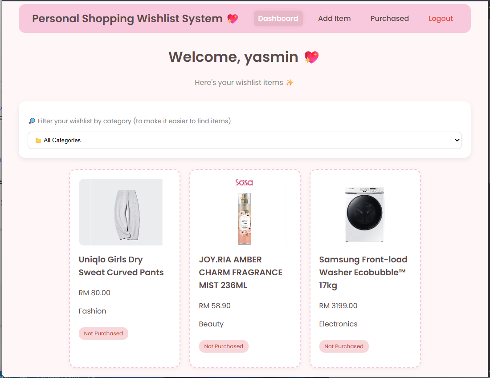
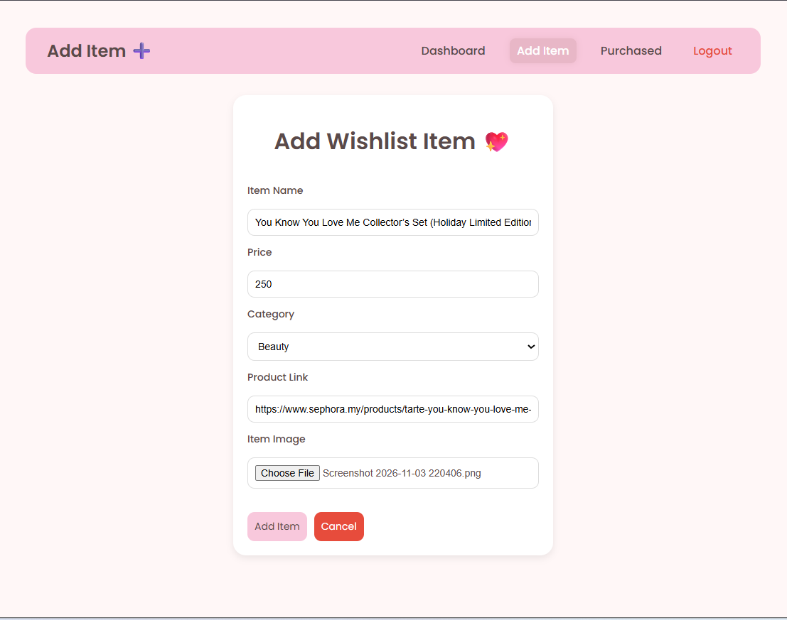
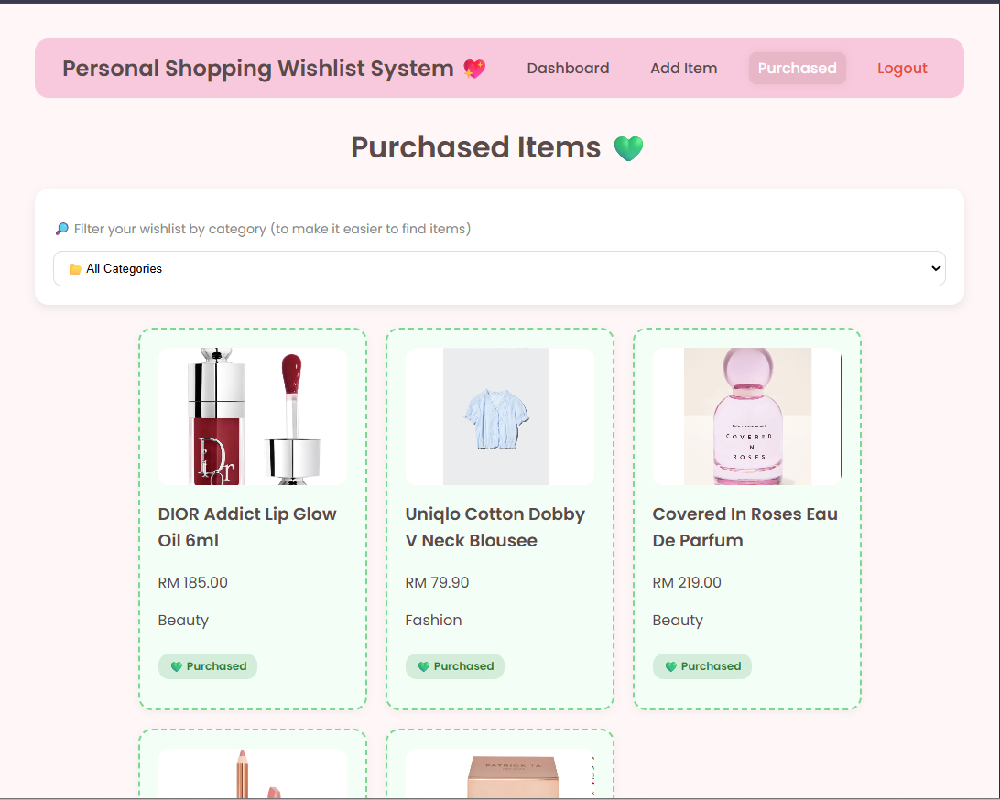

# Personal Shopping Wishlist System 🛍️
### A Web-Based Wishlist Management Application

## Overview

Personal Shopping Wishlist System is a web-based application designed to help users organise and manage items they wish to purchase.

The system allows users to save product information, including item names, prices, categories, product links, and images. Users can also track their shopping progress by categorising items into Not Purchased and Purchased statuses.

With a simple and user-friendly interface, the application provides a convenient way to manage shopping plans and keep track of desired purchases.

## Key Features

- **User Authentication** – Provides login and registration functionality for secure user access.
- **Wishlist Management** – Allows users to add, edit, and delete wishlist items.
- **Product Information** – Stores item names, prices, categories, product URLs, and images.
- **Image Upload** – Allows users to upload product images for visual identification.
- **Status Tracking** – Organises items into Not Purchased and Purchased categories.
- **Wishlist Dashboard** – Displays items that have not yet been purchased.
- **Purchased Items** – Provides a separate page to view purchased items.

## UI Preview

<table>
  <tr>
    <td align="center" width="50%">
      <strong>Login Page</strong>  
      
    </td>
    <td align="center" width="50%">
      <strong>Register Page</strong>  
      
    </td>
  </tr>
  <tr>
    <td align="center" width="50%">
      <strong>Wishlist Dashboard</strong>  
      
    </td>
    <td align="center" width="50%">
      <strong>Add Wishlist Item</strong>  
      
    </td>
  </tr>
  <tr>
    <td align="center" colspan="2">
      <strong>Purchased Items</strong>  
      
    </td>
  </tr>
</table>

## Technologies Used

- **PHP** – Server-side application development.
- **MySQL** – Database management and data storage.
- **HTML** – Web page structure.
- **CSS** – Styling and user interface design.
- **JavaScript** – Client-side functionality and interactions.

## System Functionality

| Module | Description |
|---|---|
| Authentication | Handles user registration and login. |
| Wishlist | Manages wishlist items and product information. |
| Image Upload | Stores uploaded product images. |
| Status Tracking | Tracks purchased and unpurchased items. |
| Dashboard | Displays pending wishlist items. |
| Purchased Page | Displays items marked as purchased. |

## Project Information

- **Project Name:** Personal Shopping Wishlist System
- **Platform:** Web Application
- **Project Type:** Web-Based System Development
- **Category:** Shopping / Personal Productivity
